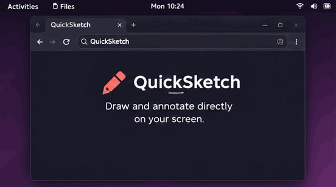

# QuickSketch
A lightweight GNOME Shell extension that lets you draw and annotate directly on your screen without switching applications.



Built for quick explanations, brainstorming, visual problem-solving, and presentations.

## Features

- Instant drawing overlay using a keyboard shortcut.
- Draw directly over any open application.
- Freehand drawing, straight lines, rectangles, and arrows.
- Multiple colors and adjustable stroke thickness.
- Undo, redo, and clear canvas.
- Dismissible keyboard shortcut guide.
- No root privileges required.
- No external dependencies or background services.

## Installation

Clone the repository:

```bash

git clone https://github.com/Seraph919/QuickSketch-GnomeShell-Extention.git
cd QuickSketch-GnomeShell-Extention
bash install.sh
```

Enable the extension:

```bash
gnome-extensions enable QuickSketch@local
```

If necessary, reload GNOME Shell using `Alt + F2`, type `r`, and press Enter (X11 only).\
On Wayland, you may need to log out and back in.

## Keyboard Shortcuts

| Shortcut | Action |
|---|---|
| `Super + Shift + D` | Open overlay |
| `Esc` | Close overlay |
| `P` | Freehand pen |
| `L` | Straight line |
| `R` | Rectangle |
| `A` | Arrow |
| `1–6` | Change color |
| `+` / `-` | Adjust stroke thickness |
| `Ctrl + Z` | Undo |
| `Ctrl + Y` | Redo |
| `C` | Clear canvas |
| `H` | Toggle shortcut guide |

## Compatibility

- GNOME Shell 42
- X11 and Wayland

## Uninstallation

```bash
bash uninstall.sh
```

## Contributing

Contributions, bug reports, and feature suggestions are welcome.

## Motivation

Sometimes, explaining an idea is easier by drawing it. QuickSketch removes the need to switch to a dedicated drawing application just to illustrate something already on your screen.
